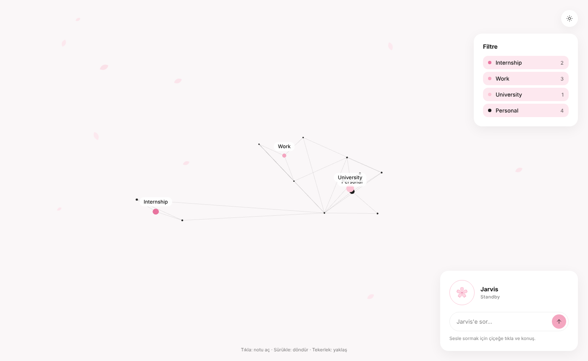

# Jarvis: Second Brain

A personal knowledge base with a **3D knowledge graph** and a **voice assistant** that answers questions from my own notes. Built on plain Markdown files, a local Python server and Claude, running privately on my own computer (and my phone via Tailscale).



> The notes in this repository are a small **sample vault**. My real notes are kept private.

## What it does

- **Markdown vault:** notes live in folders (`Router`, `Wiki`, `Concepts`, `Skills`, `Tools`, `Notes`, `Projects`, `Files`) with YAML frontmatter and `[[wiki links]]`.
- **3D knowledge graph:** every note is a node, every `[[link]]` an edge. Each note is tied to one of four hubs (Internship, Work, University, Personal), shown as large glowing nodes with a filter panel.
- **Ask Jarvis:** type or speak a question. The local server sends the vault to Claude (Haiku, through the Claude Code CLI with all tools disabled) and asks it to answer **only from the notes**. The reply comes back as JSON with the answer and the notes it used, which are highlighted in the graph. Without Claude, the page falls back to keyword search over the notes.
- **Voice in and out:** speech recognition in the browser, natural voice replies through ElevenLabs (falls back to the browser's built-in voice).
- **Reminders without AI:** saying "remind me…", "note…" or "don't forget…" appends a dated line to the reminders note. Plain Python date parsing, no model call.
- **This week panel:** a calendar note is parsed into a weekly agenda next to the graph.
- **Phone access:** one script publishes the local server privately over Tailscale, reachable only from my own devices.
- **Desktop app feel:** opens in a frameless Chrome/Edge app window and stops the server when the window closes.

## Architecture

```text
 Markdown notes ──► build-graph.ps1 ──► graph.js / graph.json
                                            │
                     index.html (3D force graph, filters, chat, voice)
                                            │  fetch /ask
                     jarvis-server.py (127.0.0.1:8765)
                       ├─ loads all notes as context
                       ├─ Claude (Haiku) via the Claude Code CLI, no tools → JSON {answer, notes}
                       ├─ ElevenLabs text-to-speech
                       └─ jarvis_reminders.py (no AI)
```

## Security and privacy choices

- The server listens on `127.0.0.1` only; requests are checked against an Origin allow-list (localhost and the private Tailscale host).
- API keys are stored **outside the vault** (`~/.jarvis/`) so they are never synced, served or committed.
- Claude is told to treat note contents as data, never as instructions (prompt-injection guard), and to answer "not in your notes" instead of guessing.
- Phone access goes through Tailscale, not a public port.

## Files

| File | Role |
|---|---|
| `index.html` | Graph UI, filter panel, weekly agenda, chat box, voice ring |
| `jarvis-server.py` | Local HTTP server, note retrieval, Claude call, TTS proxy |
| `jarvis_reminders.py` | Natural-language reminder parser (Turkish dates and weekdays) |
| `build-graph.ps1` | Reads the vault and writes `graph.json` / `graph.js` |
| `jarvis-app.ps1` | Opens Jarvis as an app window and manages the server lifecycle |
| `jarvis-phone.ps1` | Starts/stops private phone access through Tailscale |
| `Jarvis-*.bat` | One-click launchers (graph, sign in/out, voice key, microphone, phone) |

## Tech stack

Python (standard library only) · PowerShell · JavaScript · [3d-force-graph](https://github.com/vasturiano/3d-force-graph) / Three.js · Web Speech API · Claude (Haiku) · ElevenLabs · Tailscale · Windows

---

© 2026 yunalhoshi. All rights reserved. This repository is published for portfolio viewing only. See [NOTICE](NOTICE).
